<div align="center">


# Eyes

### Cameras that watch. Eyes that act.

A real-time safety network for public places. **AttackNet** spots an attack on CCTV, a **mesh** carries the alert across the city even when the internet is down, and **AI agents** dispatch help and warn people nearby over **iMessage**.

[**Live demo**](https://eyes-hacklanta.vercel.app) · [How it works](#how-it-works) · [AttackNet](#attacknet-the-model) · [iMessage agents](#ai-agents-on-imessage) · [Run it](#run-it-yourself)


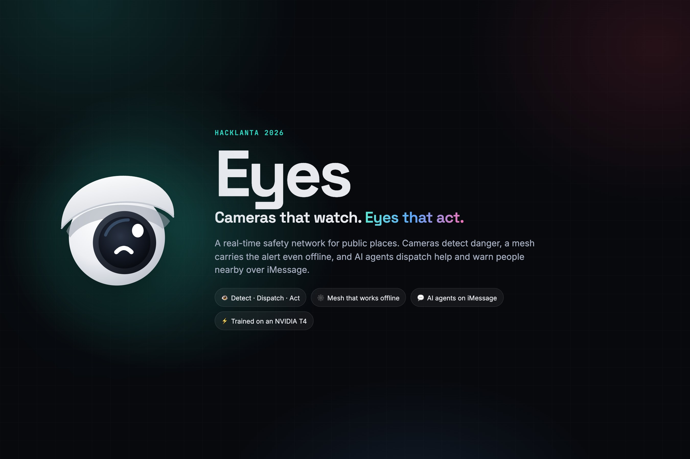

</div>

---

## Why

Riding a bus in Michigan, one of us felt unsafe, and the CCTV camera in the corner did what CCTV always does: nothing. It recorded. Nobody watched it, and nobody would until long after anything happened.

Public places are full of cameras and phones. **Eyes turns them into a network that notices and responds**, in the seconds that matter, not the hours it takes someone to pull footage.

## What it does

| | | |
|---|---|---|
| 👁 **Detect** | AttackNet reads the body language of everyone in frame (aggression, someone defending themselves, a person going down, a crowd closing in) and flags an attack. | 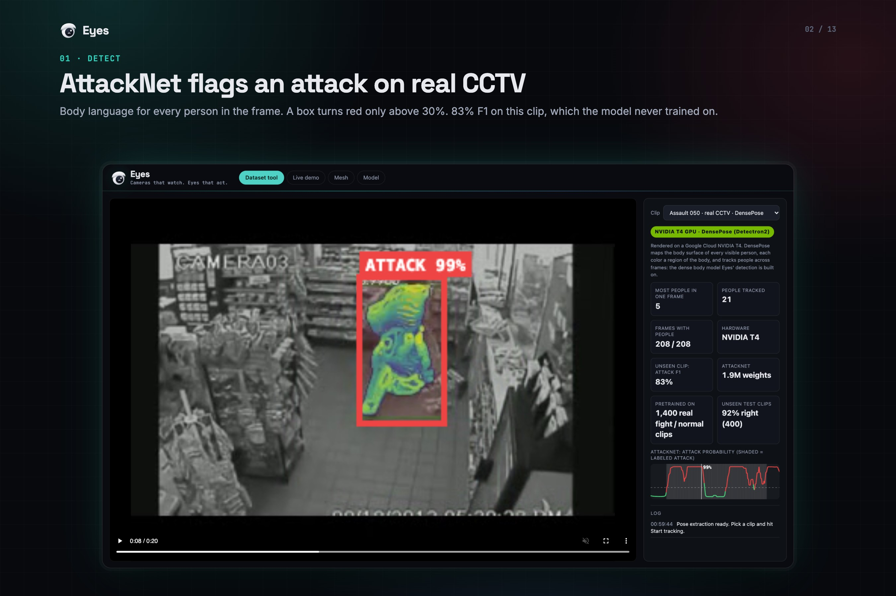 |
| 🕸 **Spread** | The incident gossips across a mesh of 130 city nodes (police, hospitals, MARTA stations, live buses) over whatever works: internet, P2P Wi-Fi or radio. | 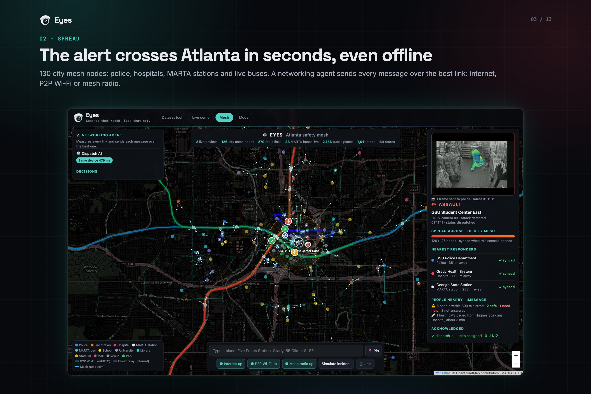 |
| 🚓 **Respond** | Officers, bus drivers and riders get the exact camera frame, the distance and a map on their phones, then respond in one tap. | 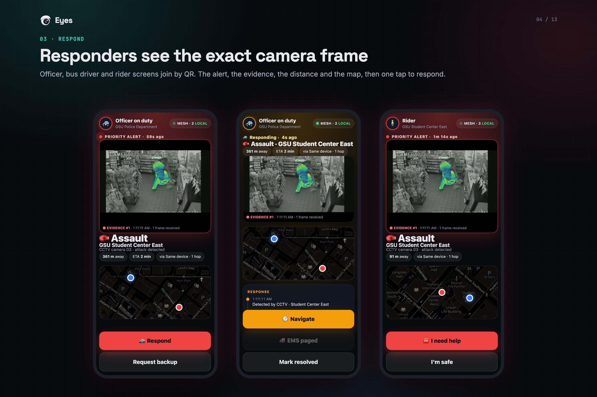 |
| 💬 **Coordinate** | A team of AI agents runs the response over iMessage: one live status card, edited in place, with the agents' brief threaded underneath. | 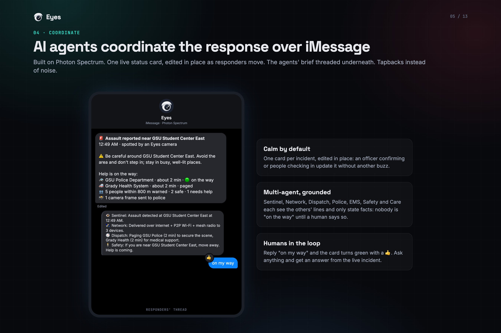 |
| 🛡 **Protect** | Anyone can text a report. People signed up nearby get a loud alert, a safe spot and an "Are you safe?" poll. Anyone hurt gets care until EMS arrives. | 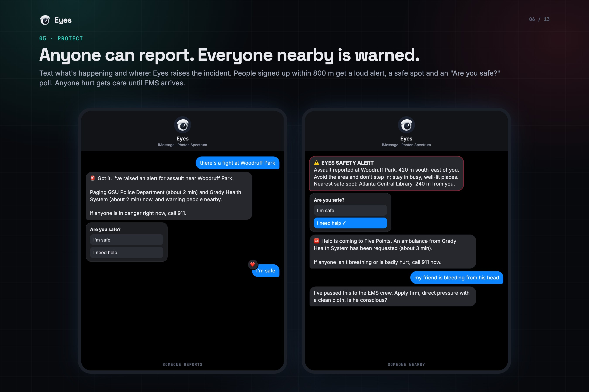 |

## How it works

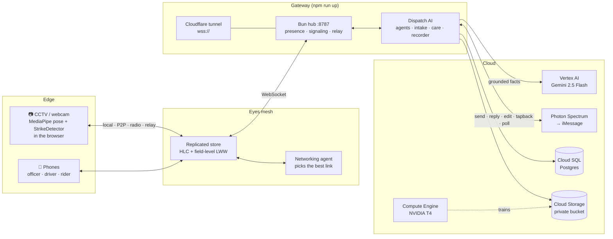

**One incident, end to end:**

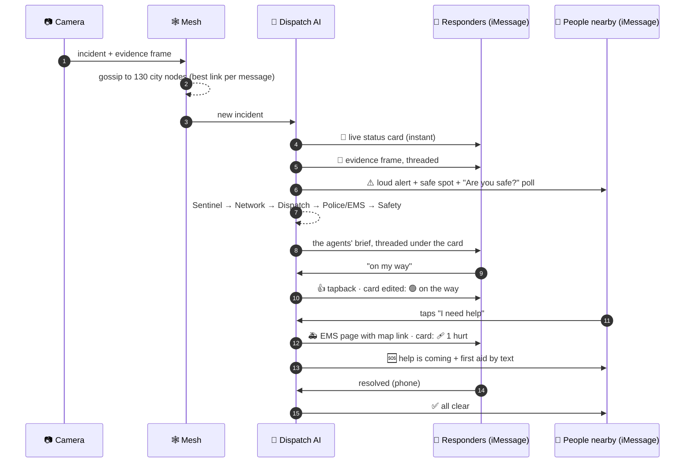

## AttackNet: the model

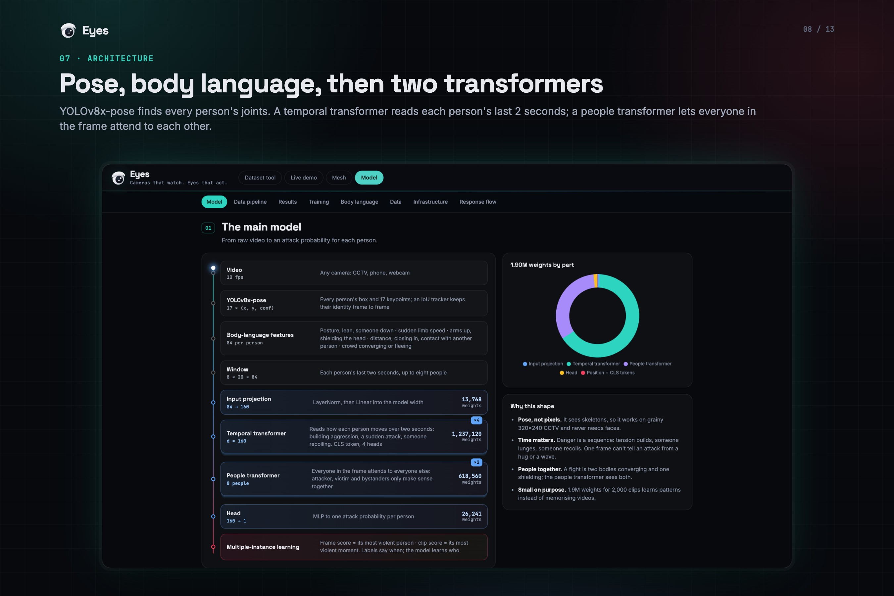

AttackNet is our own model, **1,899,209 weights**, trained on a Google Cloud **NVIDIA T4**.

```
video (10 fps)
  → YOLOv8x-pose            every person's box + 17 keypoints, tracked by IoU
  → 84 features / person     posture · lean · someone down · limb speed · arms up ·
                             shielding the head · distance · closing in · contact · crowd
  → window                   8 people × 20 frames (2 s) × 84
  → temporal transformer ×4  each person's last 2 s (CLS token, d=160, 4 heads)
  → people transformer ×2    everyone in the frame attends to everyone
  → head                     attack probability per person
  → multiple-instance        frame = most violent person · clip = most violent moment
```

**Why this shape.** It sees skeletons, not pixels, so it works on grainy 320×240 CCTV and never needs a face. Danger is a sequence (tension builds, someone lunges, someone recoils), so it reads two seconds, not one frame. A fight only makes sense with both people in view, so everyone in the frame attends to everyone else. And 1.9M weights for 2,000 clips learns patterns instead of memorizing videos.

### Results, all on footage it never trained on

| | Clips | Score |
|---|---|---|
| Real Life Violence Situations, held-out test | 400 | **91.5% accuracy · AUC 0.975** (TP 185 · FP 19 · FN 15 · TN 181) |
| Our hand-labeled CCTV, one clip held out at a time | 8 | **F1 0.628 · AUC 0.725** (v1: F1 0.563 · AUC 0.639) |
| Sparring clips, kept out of training entirely | 4 | F1 0.614 · AUC 0.508 |

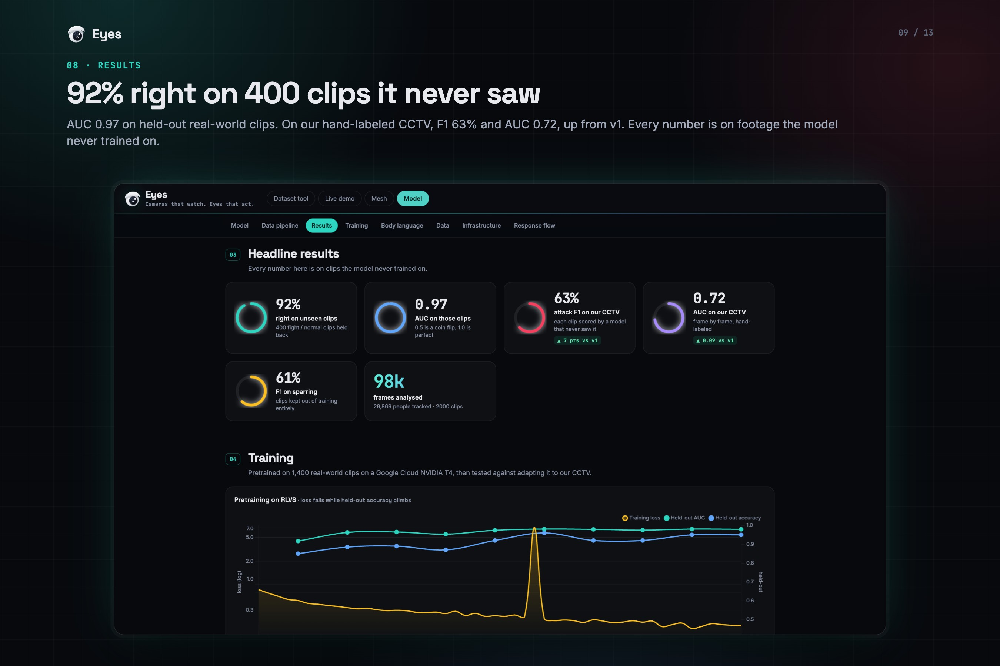 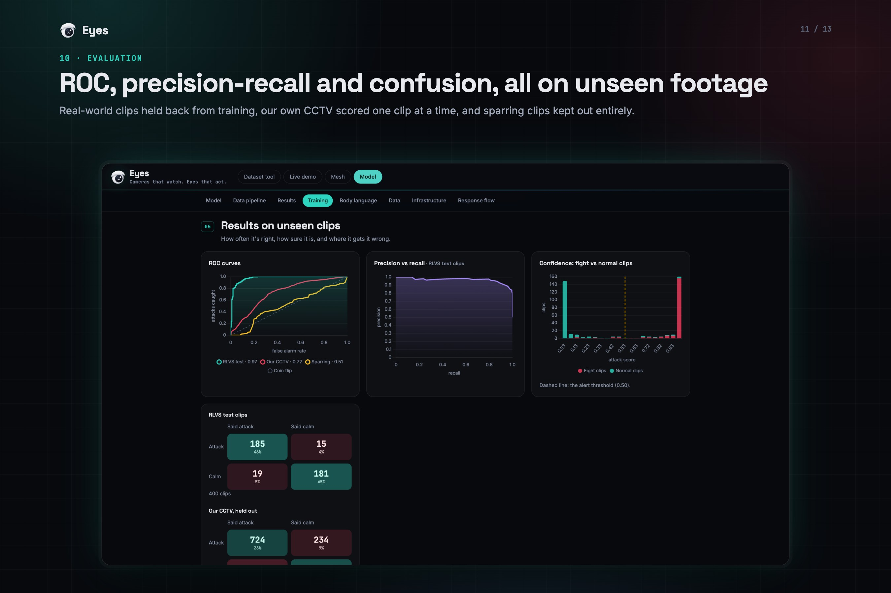

**How it was trained.** Stage A pretrains on [Real Life Violence Situations](https://www.kaggle.com/datasets/mohamedmustafa/real-life-violence-situations-dataset) (1,000 fight + 1,000 normal clips, split 70/10/20 by clip; thresholds set on validation only). Stage B fine-tuned on our own clips with leave-one-clip-out; it scored *worse* on unseen clips, so we ship Stage A and say so. The full report (training curves, ROC and PR, confusion matrices, permutation importance, data charts) is live in the app's **Model** tab and in [`data/attack/out/report.json`](data/attack/out/report.json).

**Honest limits.** It still confuses sparring with real fighting (AUC 0.51). On a calm bus-stop clip it flags 37% of frames at the trained threshold, so the Dataset tool only paints a box red above 30%. One unstable epoch spiked the loss to 7.4 before training recovered; it's on the chart. Small data: we'd rather show real numbers than pretty ones.

## AI agents on iMessage

Built on [Photon Spectrum](https://photon.codes/spectrum). The agents don't just send alerts: they **participate**, take reports, answer questions and hand off to humans.

- **A team, not a bot.** Sentinel (the camera), Intake (reports from people), Network, Dispatch, Police, EMS, Safety and Care take turns; each sees the others' lines. Every fact comes from our data (nearest responders, distances, ETAs, which networks are up, who acknowledged); Gemini only words it.
- **Calm by default.** One live status card per incident, **edited in place** as responders confirm and people check in, so updates don't buzz your phone. The agents' brief and police photos arrive as **threaded replies**. Acknowledgements are **native tapbacks** (👍 for "on my way", ❤️ for "I'm safe"). Only urgent changes notify: someone hurt, or resolved.
- **Humans in the loop.** Nobody is ever "on the way" until a human says so. Reply "on my way" and the card turns 🟢. Ask "what's happening?" and get an answer grounded in the live incident.
- **Anyone can report.** "There's a fight at Woodruff Park" becomes a real incident at that place, run through the whole response. No place? It asks where (or uses your saved place for "here"). A second report nearby joins the live incident instead of duplicating it.
- **People nearby are warned.** Opt-in: text `JOIN` and a place; `STOP` to leave. Within 800 m you get a loud alert with the distance, the direction, a safe spot and a one-tap **"Are you safe?" poll**.
- **Care until EMS arrives.** "I need help" pages EMS with a map link and the latest camera frame, gives standard first-aid guidance by text, relays everything the person says to the crew, and tells them when the ambulance confirms.
- **Safety rails.** Always "call 911" when there's danger (Eyes can't place calls). Phone numbers never go on the mesh, only counts and ~100 m dots. Fallback text for every agent if the model is down. Dry-run mode prints instead of sending.

## The mesh

Our own replicated store, not an SDK. Every device holds the incident, so it survives any one link going down.

- **Hybrid logical clock + field-level last-writer-wins**: concurrent edits from different phones merge without conflicts.
- **Gossip of fresh ops only**, chunked to 48 KB, with per-link exclusions (evidence frames don't flood the city mesh).
- **Four transports**: same device, P2P Wi-Fi (WebRTC), mesh radio (simulated hop delay and range), internet relay (Bun hub over a Cloudflare tunnel).
- **A networking agent** pings every link for RTT and loss, routes each message over the best one with a reason you can read, fails over and resyncs with a snapshot.
- **Atlanta, for real**: 2,155 public places from OpenStreetMap, 7,011 MARTA stops and 169 routes from GTFS, and live bus positions from GTFS-realtime.

## Run it yourself

**Prerequisites:** [Bun](https://bun.sh), Node 20+, and for the agents a [Photon](https://photon.codes) project and a Google Cloud project with Vertex AI.

```bash
git clone https://github.com/kbhatnagar1506/eyes.git && cd eyes
npm install
cp .env.example .env        # fill in Photon + GCP; EYES_SEND=0 is a dry run
```

```bash
npm run dev                 # the app on http://localhost:5173
```

```bash
npm run up                  # hub + Cloud SQL proxy + Cloudflare tunnel + Dispatch AI agents
```

Open the app, then **Live demo** (webcam), **Mesh** (the Atlanta map) or **Model** (the training report). Phones join with `?role=police`, `?role=driver` or `?role=rider`, or scan the QR code from **Join** on the map.

**Rehearse without a camera**, against any hub:

```bash
EYES_HUB=ws://127.0.0.1:8787/mesh bun scripts/test/raise.ts assault full
```

**Tests:**

```bash
bun scripts/test/people.test.ts    # sign-ups, area alert, polls, care, EMS, all clear
bun scripts/test/intake.test.ts    # reports, "where?", duplicates, questions, chat (model up and down)
npm run test:mesh                  # the replicated store and transports
```

**Retrain AttackNet** on a GCP NVIDIA T4: [`scripts/attack/run_rlvs.sh`](scripts/attack/run_rlvs.sh) downloads RLVS, tracks every person with YOLOv8x-pose, trains, evaluates and uploads the report.

## Repository map

```
src/                 the web app (Vite + TypeScript)
  main.ts            camera console: Dataset tool, Live demo, tabs
  strike.ts          StrikeDetector: hitboxes, body-relative hand speed
  meshview.ts        the Atlanta mesh map and incident panel
  phone.ts           officer / driver / rider phone screens
  modelview.ts       the Model tab: architecture, training, results, infra
  mesh/              the replicated store, HLC, transports, hub client, geocoder
server/              the gateway (Bun)
  agents.ts          Dispatch AI: agents, live card, Photon iMessage
  intake.ts          the front door: reports, questions, chat
  people.ts          opt-in area alerts, polls, care, all clear
  hub.ts · tunnel.ts · recorder.ts · up.ts
scripts/attack/      AttackNet: pose extraction, training, GPU job scripts
scripts/devpost/     headless-Chrome screenshots and gallery slides
data/attack/         labels, the trained model and its full report
api/buses.ts         Vercel function: live MARTA buses
```

## Built with

**App** Vite · TypeScript · Leaflet · MediaPipe Pose · Chart.js
**Gateway** Bun · WebSocket · WebRTC · Cloudflare Tunnel
**AI** PyTorch · YOLOv8x-pose · DensePose (Detectron2) · Gemini 2.5 Flash on Vertex AI
**Messaging** Photon Spectrum (iMessage: edits, threaded replies, tapbacks, polls, effects)
**Cloud** Vercel · Google Cloud: Compute Engine (NVIDIA T4), Cloud SQL Postgres, Cloud Storage

## Data and credits

- [Real Life Violence Situations](https://www.kaggle.com/datasets/mohamedmustafa/real-life-violence-situations-dataset) (Soliman et al.): AttackNet pretraining.
- [UCF-Crime](https://www.crcv.ucf.edu/projects/real-world/) (Sultani et al.): CCTV evaluation clips, used for research only and **not redistributed** in this repo.
- Stock footage from [Pexels](https://www.pexels.com).
- Map data © [OpenStreetMap](https://www.openstreetmap.org/copyright) contributors; transit data from [MARTA](https://itsmarta.com) GTFS and GTFS-realtime.
- [Ultralytics YOLOv8](https://github.com/ultralytics/ultralytics) (AGPL-3.0) for pose, [MediaPipe](https://developers.google.com/mediapipe) for in-browser pose, [Detectron2 DensePose](https://github.com/facebookresearch/detectron2) for GPU renders.

## License

Our code is [MIT](LICENSE). Datasets and third-party models keep their own licenses.

<div align="center">
<br/>
<br/>
<sub>Built at Hacklanta 2026 · <a href="https://eyes-hacklanta.vercel.app">eyes-hacklanta.vercel.app</a></sub>
</div>
